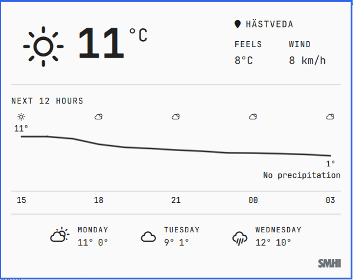

# SMHI weather for the Omarchy bar

**Hourly SMHI forecasts in the Omarchy weather panel: the next 12 hours of temperature and precipitation, one click from the bar.**

Hästveda, 18 October 2026. The Omarchy weather panel can now show forecasts from SMHI, the Swedish Meteorological and Hydrological Institute. The stock panel shows current conditions and three daily highs and lows from Open-Meteo or wttr.in. This plugin replaces both with SMHI's `snow1g` point forecast. It also adds charts for the next 12 hours: temperature as a line, precipitation as bars, and a condition icon every third hour. Hovering over the chart shows the time, temperature, precipitation amount and probability, and wind speed for that hour.



## The problem

The stock panel can't answer "will it rain on the way home" or "how cold does it get tonight". It shows one current reading and three daily min/max pairs, and nothing between now and tomorrow. Its sources are global models. For Sweden and the Nordic area, SMHI is the national forecaster, and its point forecast is what Swedish weather services publish.

## The solution

- **SMHI as the only forecast source.** One HTTPS request per refresh, about 68 KB, answered in 0.29 s (3 of 3 runs from Hästveda, 18 October 2026). The API returns 84 timesteps over 10 days: 59 hourly, then 3-, 6- and 12-hourly steps.
- **Next 12 hours.** 13 hourly points starting at the current hour. The temperature line labels only its high and low. Precipitation bars share the same time axis but have their own scale, with a 1 mm/h minimum so drizzle doesn't look like a downpour. When the 12 hours are dry, the chart says "No precipitation" instead of showing empty bars.
- **Daily forecast.** The next three days' highs and lows, aggregated from the same timeseries in local time, with the condition icon taken from the step closest to 12:00.
- **Attribution.** A small SMHI wordmark in the panel footer. It appears only after an SMHI forecast has loaded and switches between black and white versions to suit the theme.
- **Humidity removed.** The panel now shows feels-like temperature and wind.

## Getting started

Requires Omarchy 4.0.4 or later. The plugin is a modified clone of the built-in `omarchy.weather` plugin from that version.

```bash
git clone https://github.com/ecomodeller/omarchy-weather-smhi ~/.config/omarchy/plugins/henrik.weather
```

In `~/.config/omarchy/shell.json`, change the bar entry `"id": "omarchy.weather"` to `"id": "henrik.weather"`. The shell reloads `shell.json` automatically; if the panel doesn't change, run `omarchy restart shell`.

Set the location by clicking the location name in the panel. It is stored in `~/.local/state/omarchy/settings/weather.json` as `{"name", "latitude", "longitude"}`.

## FAQ

### For users

**Where does SMHI have data?**
The Nordic area only. For a point outside it, for example Paris, the API answers HTTP 404. In that case the panel keeps the last report it had, and the SMHI logo doesn't appear until an SMHI fetch succeeds. There is deliberately no fallback to another provider.

**Is the forecast for my exact coordinates?**
It's for the nearest SMHI grid point. For Hästveda (56.28468 N, 13.93547 E), SMHI answers for 56.274412 N, 13.952537 E, about 1.6 km away (great-circle distance).

**Where does "feels like" come from?**
SMHI doesn't publish an apparent temperature, so the plugin calculates one from SMHI's air temperature, relative humidity and wind speed, using Steadman's formula without the radiation term (`apparentTemperature` in `Model.js`). It can differ by a degree or two from other services that include sunshine.

**How does the panel know whether it's night?**
From the solar elevation at the forecast location, calculated locally (`solarElevation` in `Model.js`). SMHI's weather symbols don't say whether it's day or night.

**How are SMHI weather symbols turned into icons?**
SMHI's symbols 1–27 are mapped to WMO 4677 weather codes (`SMHI_SYMBOL_TO_WMO` in `Model.js`), and those codes pick the existing icons. Sleet uses WMO 68/69, which shows the sleet icon.

**How often does it refresh?**
Every 15 minutes by default. You can change this with the widget's `refreshMinutes` setting. SMHI updates its forecast roughly every hour (`referenceTime` in the response).

### Internal

**What still calls services other than SMHI?**
Two things.

- **wttr.in:** the inherited code fetches `wttr.in` on every refresh. Once a location with coordinates is set, its current conditions are ignored. It is still used for IP-based location detection when no location is set, and for the country that picks metric or imperial units.
- **Open-Meteo:** location search in the panel uses Open-Meteo's geocoding API, because SMHI has no place-name search.

Removing both is open work.

**Why is SMHI data converted to Open-Meteo's response format?**
The inherited panel already reads Open-Meteo's `{current, daily}` format. `smhiAsOpenMeteo` in `Model.js` converts SMHI's timeseries into that format and adds an `hourly` array, so almost none of the panel code needed to change. Compared with the built-in plugin, this plugin adds `HourlyChart.qml`, 118 lines in `Model.js`, and a few lines in `Panel.qml` (the fetch, the chart, the footer, and the removed humidity column).

**What happens when Omarchy updates the built-in weather plugin?**
Nothing happens to this plugin automatically, because it's a separate copy. Upstream changes have to be merged in by hand. Compare against `/usr/share/omarchy/shell/plugins/panels/weather/`.

**Which SMHI API version is used?**
`snow1g` version 1 ([docs](https://opendata.smhi.se/metfcst/snow1gv1), [parameters](https://opendata.smhi.se/metfcst/snow1gv1/parameters)). The older `pmp3g` version 2 endpoint now answers 404.

**Data and logo terms.**
The forecast data is SMHI open data; see SMHI's terms on the [open data portal](https://opendata.smhi.se/). The SMHI wordmark is SMHI's own and is included only to credit SMHI as the data source.
